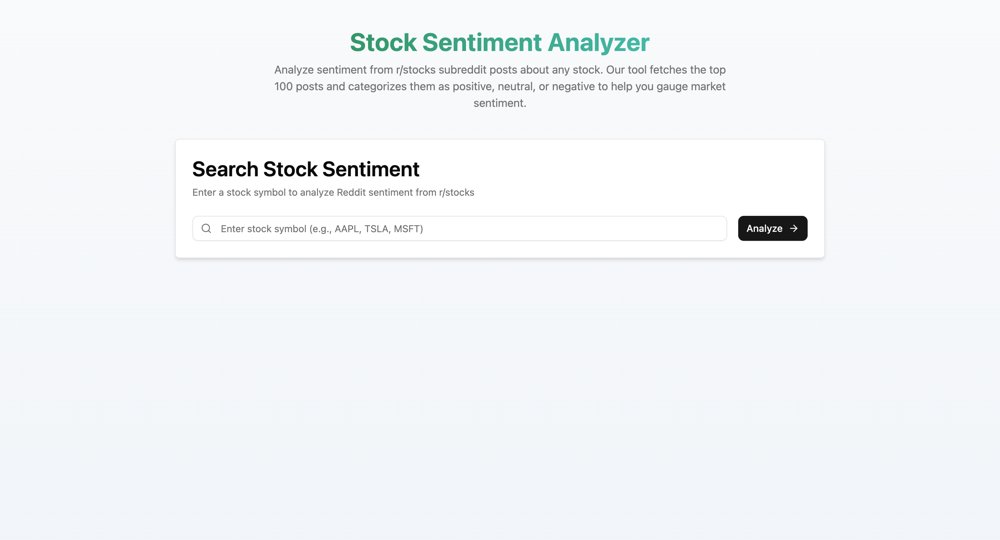
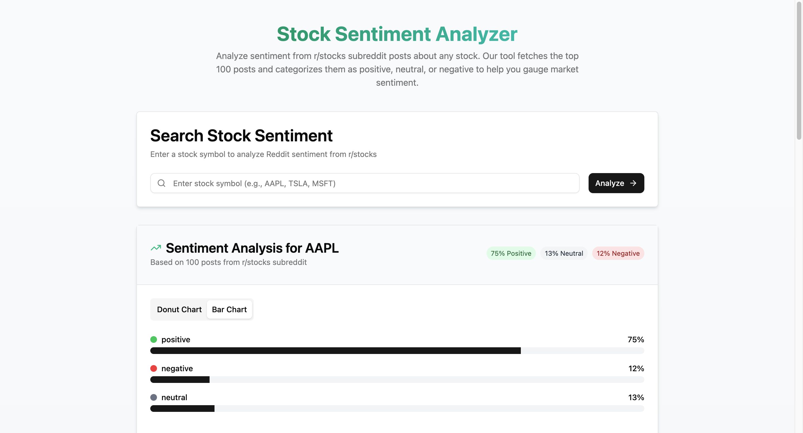
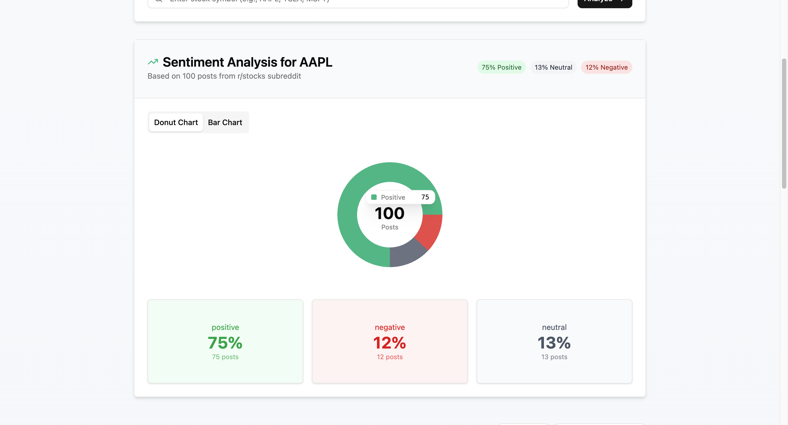
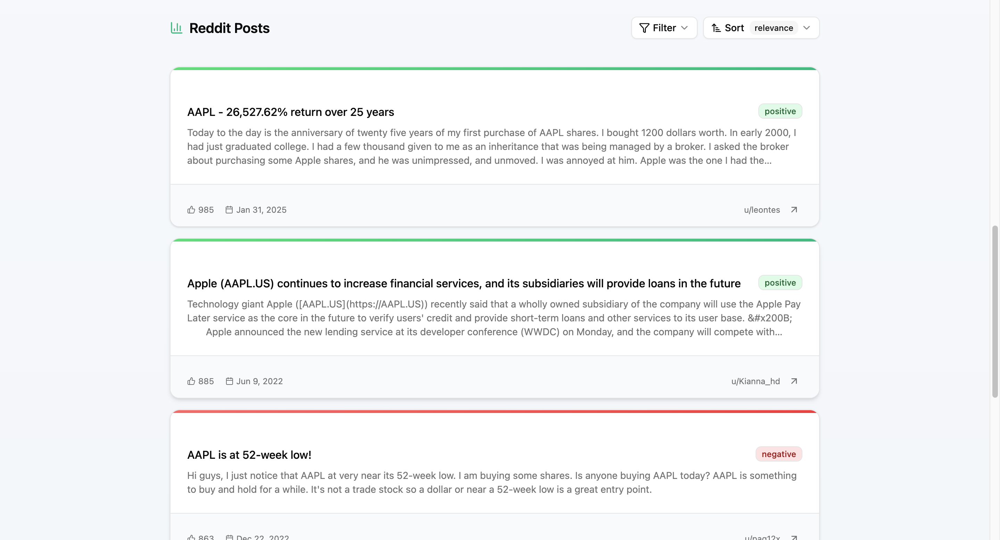

# Reddit stock sentiment analyzer

I wanted a quick way to tell whether Reddit is bullish or bearish on a ticker, so I built this. Type in a stock symbol and it pulls up to 100 recent posts from finance subreddits, then labels each one Positive, Neutral, or Negative. FastAPI on the backend, React (Vite) on the frontend.

## Features

- Pulls up to 100 recent matching posts from several finance subreddits
- Labels each post Positive, Neutral, or Negative with a trained classifier
- Uses FinBERT embeddings plus word count and VADER scores as inputs
- Shows a donut and bar breakdown plus the post list with filter and sort
- Backend returns clear errors (bad symbol, no posts, Reddit down) and the frontend surfaces them instead of hanging

## Screenshots









## Getting started

### 1. Clone the repo

```bash
git clone https://github.com/anismabaziz/stock-mood
cd stock-mood
```

### 2. Backend setup

```bash
cd backend

# Install uv if you don't have it yet
# macOS/Linux: curl -LsSf https://astral.sh/uv/install.sh | sh

# Installs deps into .venv
uv sync
```

Needs Python 3.11 or 3.12.

### 3. Environment files

Backend `.env`:

```bash
reddit_client_id='your reddit client_id'
reddit_client_secret='your reddit client_secret'
reddit_user_agent='your reddit user_agent'
frontend_url='frontend dev url'
frontend_build='frontend production url'
```

Frontend `.env`:

```bash
VITE_API_URL='backend dev url'
```

### 4. Frontend setup

```bash
cd ../frontend
npm install
```

## Running it

Start the backend:

```bash
cd backend
uv run uvicorn main:app --reload
```

- Health check: `http://127.0.0.1:8000/ping`
- API docs: `http://127.0.0.1:8000/docs`

Start the frontend:

```bash
cd frontend
npm run dev
```

If the frontend can't reach the backend, check `frontend/.env`:

```bash
VITE_API_URL=http://127.0.0.1:8000
```

Then restart the dev server.

## How the model works

I tried a bunch of classifiers before settling: logistic regression, random forest, gradient boosting, SVM, XGBoost, an MLP from scikit-learn, and a neural net I wrote myself. The custom net did best, so that's what's serving.

Inputs per post:

- FinBERT embeddings (768 dims, from a BERT trained on financial text)
- Word count
- VADER compound, positive, neutral, and negative scores

It lands around 80% accuracy on my held-out validation set. One thing to know: I trained on labeled financial news, not Reddit posts, so slang and memes can throw it off. Good enough for a directional read, not something I'd trade on alone.

## Tech stack

Frontend:

- React (Vite)
- Axios

Backend:

- FastAPI
- PRAW
- FinBERT via HuggingFace Transformers
- VADER via NLTK
- scikit-learn / TensorFlow
- XGBoost
